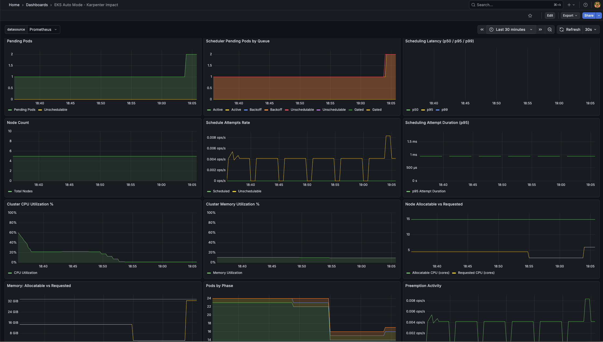
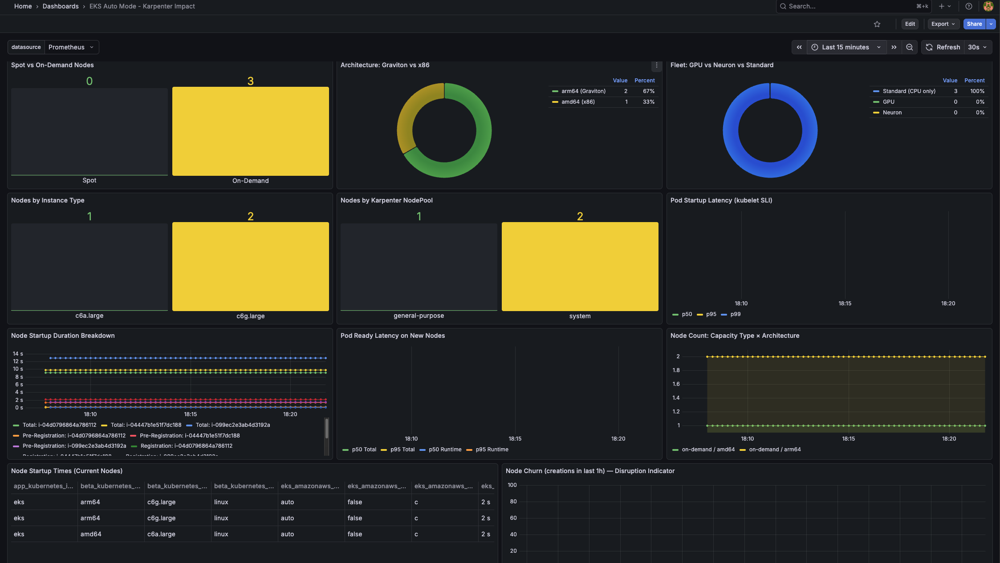
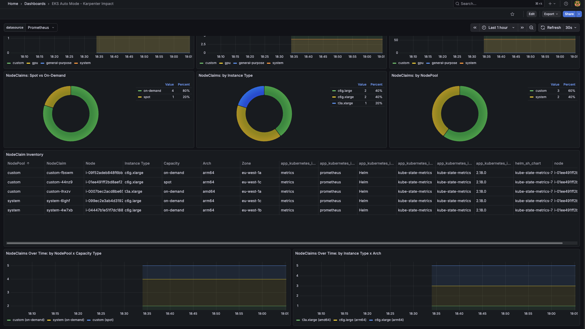

# How to observe Karpenter on Amazon EKS Auto Mode with Prometheus and Grafana

This sample deploys a self-contained Prometheus and Grafana stack, installed with Helm,
on an [Amazon EKS Auto Mode](https://docs.aws.amazon.com/eks/latest/userguide/automode.html)
cluster. It includes a 35-panel **EKS Auto Mode - Karpenter Impact** Grafana dashboard.

In EKS Auto Mode, Karpenter runs as a managed control plane component. There are no
Karpenter pods to scrape and its native metrics are not exposed. This sample observes
Karpenter through its effects on the cluster instead: pending pods, scheduling latency,
node scaling and churn, and fleet composition. It also builds `karpenter_*` metrics
directly from the `NodePool`, `NodeClaim`, and `NodeClass` resources.



## Prerequisites

1. An existing Amazon EKS cluster with **EKS Auto Mode** enabled, running Kubernetes
   1.28 or later. See the [eksctl Auto Mode sample](../../eksctl/how-to-eks-auto-mode/)
   to create one.
2. [kubectl](https://docs.aws.amazon.com/eks/latest/userguide/install-kubectl.html)
   configured to talk to your cluster, with permission to create namespaces and
   cluster-scoped RBAC.
3. [Helm](https://helm.sh/docs/intro/install/) v3.
4. `python3` on your workstation (optional, used by `setup.sh` to report scrape target health).

## How it works

```
┌─────────────────────────────────────────────────────────────────┐
│ EKS Auto Mode Cluster                                           │
│                                                                 │
│  ┌──────────────┐    ┌──────────────────────────────────────┐   │
│  │  Prometheus  │───▶│ Scrape Targets                       │   │
│  │  Server      │    │  • kube-scheduler (ksh) via          │   │
│  │              │    │    metrics.eks.amazonaws.com API     │   │
│  │              │    │  • kube-controller-manager (kcm) via │   │
│  │              │    │    metrics.eks.amazonaws.com API     │   │
│  │              │    │  • Node Exporter (with ethtool)      │   │
│  │              │    │  • kube-state-metrics (node labels   │   │
│  │              │    │    and Karpenter CRDs)               │   │
│  │              │    │  • kubelet and cAdvisor              │   │
│  └──────┬───────┘    └──────────────────────────────────────┘   │
│         │                                                       │
│  ┌──────▼───────┐                                               │
│  │   Grafana    │──▶ 35-panel "Karpenter Impact" dashboard      │
│  │  (ClusterIP) │                                               │
│  └──────────────┘                                               │
└─────────────────────────────────────────────────────────────────┘
          ▲
          │ kubectl port-forward
     your workstation
```

| File | Purpose |
|---|---|
| `dashboards/karpenter-impact.json` | Portable Grafana dashboard (35 panels). Uses a `${DS_PROMETHEUS}` datasource variable, so it also imports into an existing Grafana. |
| `helm-values/prometheus-values.yaml` | Values for the `prometheus-community/prometheus` chart: EKS control plane scrape jobs, node-exporter ethtool collector, kube-state-metrics node labels and Karpenter Custom Resource State metrics. |
| `helm-values/grafana-values.yaml` | Values for the `grafana-community/grafana` chart: Prometheus datasource, dashboard provisioning, ClusterIP `Service`. |
| `manifests/rbac-eks-control-plane-metrics.yaml` | `ClusterRole` and `ClusterRoleBinding` that let Prometheus read `ksh/metrics` and `kcm/metrics`. |
| `scripts/setup.sh` | One-command deploy into the `monitoring` namespace. |
| `scripts/teardown.sh` | Removes everything `setup.sh` created. |

| Component | Chart | Purpose |
|---|---|---|
| Prometheus server | [`prometheus-community/prometheus`](https://github.com/prometheus-community/helm-charts/tree/main/charts/prometheus) | Metrics collection and storage |
| Node Exporter | (bundled) | Node-level metrics, with `--collector.ethtool` for ENA statistics |
| kube-state-metrics | (bundled) | Kubernetes object metrics, Karpenter node labels, and Karpenter CRD metrics |
| Grafana | [`grafana-community/grafana`](https://github.com/grafana-community/helm-charts/tree/main/charts/grafana) | Visualization |

`setup.sh` pins both chart versions. To try newer releases, set `PROMETHEUS_CHART_VERSION`
or `GRAFANA_CHART_VERSION` before running it.

### Security notes

- Grafana's `Service` is **ClusterIP only**, so the dashboard is not reachable from outside
  the cluster. Reach it from your workstation with `kubectl port-forward`, which listens
  on `localhost` only. Do not add `--address 0.0.0.0` to the port-forward.
- The Grafana chart generates a random admin password and stores it in the `grafana`
  Secret. The setup script prints the command to read it, not the password itself.
- Prometheus, Alertmanager, kube-state-metrics, and Pushgateway also use ClusterIP
  `Service`s. Node Exporter uses host networking (required for the ethtool collector) and
  listens on port 9100 of each node, which is reachable only from sources your cluster
  security group allows.
- The EKS control plane scrape jobs verify the API server's TLS certificate against the
  in-cluster CA.
- Prometheus has no persistent storage in this sample. Metrics are lost when the pod restarts.

> This sample is for testing and learning only. Always follow the
> [Amazon EKS Security Best Practices](https://aws.github.io/aws-eks-best-practices/security/docs/)
> for production clusters.

## Usage

1. Clone the repository and change to this sample's directory:

    ```sh
    git clone https://github.com/aws-samples/aws-eks-samples.git
    cd aws-eks-samples/examples/helm/how-to-eks-auto-mode-karpenter-observability
    ```

2. Run the setup script:

    ```sh
    ./scripts/setup.sh
    ```

    The script:

    1. Checks for `kubectl`, `helm`, cluster access, and the `metrics.eks.amazonaws.com` API
    2. Creates the `monitoring` namespace
    3. Applies the RBAC for EKS control plane metrics
    4. Installs Prometheus with the custom scrape configuration
    5. Creates the `grafana-dashboards` ConfigMap from `dashboards/karpenter-impact.json`
    6. Installs Grafana with the Prometheus datasource and the dashboard
    7. Reports the health of the `ksh-metrics` and `kcm-metrics` scrape targets

3. Port-forward Grafana to your workstation:

    ```sh
    kubectl -n monitoring port-forward svc/grafana 3000:80
    ```

4. In another terminal, read the admin password:

    ```sh
    kubectl -n monitoring get secret grafana -o jsonpath='{.data.admin-password}' | base64 -d; echo
    ```

5. Open http://localhost:3000, sign in as `admin`, and open
   **Dashboards > EKS Auto Mode - Karpenter Impact**. Allow 2 to 3 minutes for metrics to
   populate.

To see Karpenter react, scale a workload beyond current capacity and watch pending pods,
node count, and NodeClaims change on the dashboard.

## Dashboard panels



### Scheduling health

| Panel | Metric source | Description |
|---|---|---|
| Pending Pods | kube-state-metrics | Pods in Pending phase and unschedulable count |
| Scheduler Pending Pods by Queue | ksh (scheduler) | Active, backoff, unschedulable, and gated queues |
| Scheduling Latency (p50/p95/p99) | ksh (scheduler) | End-to-end pod scheduling SLI |

### Scheduling activity and node scaling

| Panel | Metric source | Description |
|---|---|---|
| Node Count | kube-state-metrics | Total nodes over time, showing Karpenter scaling |
| Schedule Attempts Rate | ksh (scheduler) | Scheduled, unschedulable, and error rates |
| Scheduling Attempt Duration (p95) | ksh (scheduler) | Per-attempt scheduling latency |

### Cluster utilization

| Panel | Metric source | Description |
|---|---|---|
| Cluster CPU Utilization % | node-exporter | Aggregate CPU with 70% and 90% thresholds |
| Cluster Memory Utilization % | node-exporter | Aggregate memory with 70% and 90% thresholds |
| CPU: Allocatable vs Requested | kube-state-metrics | Headroom Karpenter maintains |

### Capacity and pod lifecycle

| Panel | Metric source | Description |
|---|---|---|
| Memory: Allocatable vs Requested | kube-state-metrics | Memory headroom |
| Pods by Phase | kube-state-metrics | Stacked Running, Pending, Failed, and Succeeded |
| Preemption Activity | ksh (scheduler) | Preemption attempts rate |

### Per-node breakdown

| Panel | Metric source | Description |
|---|---|---|
| Per-Node CPU Usage % | node-exporter | Individual node CPU |
| Per-Node Memory Usage % | node-exporter | Individual node memory |
| Node Conditions | kube-state-metrics | Ready status table |

### Fleet composition

| Panel | Metric source | Description |
|---|---|---|
| Spot vs On-Demand Nodes | kube-state-metrics (labels) | Capacity type distribution |
| Architecture: Graviton vs x86 | kube-state-metrics (labels) | arm64 vs amd64 |
| Fleet: GPU vs Neuron vs Standard | kube-state-metrics (labels) | Accelerator breakdown |

### Instance breakdown

| Panel | Metric source | Description |
|---|---|---|
| Nodes by Instance Type | kube-state-metrics (labels) | For example `c6g.large`, `m5.xlarge` |
| Nodes by Karpenter NodePool | kube-state-metrics (labels) | For example `system`, `general-purpose` |
| Pod Startup Latency (kubelet SLI) | kubelet | p50, p95, and p99 pod start time |

### Node and pod readiness

| Panel | Metric source | Description |
|---|---|---|
| Node Startup Duration Breakdown | kubelet | Pre-registration, registration, and post-registration |
| Pod Ready Latency on New Nodes | kubelet | Total and runtime pod start durations |
| Node Count: Capacity Type × Architecture | kube-state-metrics (labels) | Fleet composition over time |

### Disruption and churn

| Panel | Metric source | Description |
|---|---|---|
| Node Startup Times (Current Nodes) | kubelet | Table with color thresholds (under 30s green, under 60s yellow, over 60s red) |
| Node Churn (creations in last 1h) | kube-state-metrics | Tracks Karpenter disruption and consolidation |



### Karpenter CRD: NodePool resources

| Panel | Metric source | Description |
|---|---|---|
| NodePool: Node Count | `karpenter_nodepool_node_count` | Nodes per NodePool over time |
| NodePool: Total CPU Cores | `karpenter_nodepool_resource_cpu_cores` | Aggregate CPU per NodePool |
| NodePool: Pod Capacity | `karpenter_nodepool_resource_pods` | Total pod slots per NodePool |

### Karpenter CRD: NodeClaim distribution

| Panel | Metric source | Description |
|---|---|---|
| NodeClaims: Spot vs On-Demand | `karpenter_nodeclaim_info` | Capacity type distribution |
| NodeClaims: by Instance Type | `karpenter_nodeclaim_info` | EC2 instance types |
| NodeClaims: by NodePool | `karpenter_nodeclaim_info` | NodePool assignment |

### Karpenter CRD: NodeClaim inventory and trends

| Panel | Metric source | Description |
|---|---|---|
| NodeClaim Inventory | `karpenter_nodeclaim_info` | Table of NodePool, node, instance type, capacity type, architecture, and zone |
| NodeClaims Over Time: by NodePool × Capacity Type | `karpenter_nodeclaim_info` | Stacked time series |
| NodeClaims Over Time: by Instance Type × Arch | `karpenter_nodeclaim_info` | Stacked time series |

## Design decisions

### Observing Karpenter through its effects

Because Karpenter runs in the EKS Auto Mode control plane, the dashboard reads
Karpenter's behavior from the cluster:

- Pending pods lead Karpenter to provision nodes, so node count increases.
- Scheduling latency shows how quickly pods are placed once nodes are ready.
- Node churn reflects consolidation and disruption.
- Fleet composition shows what Karpenter chose to provision.

### EKS control plane metrics through the API server

The kube-scheduler (`ksh`) and kube-controller-manager (`kcm`) metrics are
[served by the API server](https://docs.aws.amazon.com/eks/latest/userguide/view-raw-metrics.html) at:

```
/apis/metrics.eks.amazonaws.com/v1/ksh/container/metrics
/apis/metrics.eks.amazonaws.com/v1/kcm/container/metrics
```

Reading them requires `get` on the `ksh/metrics` and `kcm/metrics` resources in the
`metrics.eks.amazonaws.com` API group, granted by
`manifests/rbac-eks-control-plane-metrics.yaml`. That RBAC lives outside the Helm release
so that re-running the setup or upgrading the chart doesn't drop or duplicate it.

Each job scrapes one target, `kubernetes.default.svc:443`. Discovering every API server
endpoint instead returns the same scheduler and controller-manager series once per
endpoint, which doubles any panel that uses `sum()`.

### Node labels for fleet visibility

kube-state-metrics uses `metricLabelsAllowlist` to expose these Karpenter-managed node
labels on the `kube_node_labels` metric:

- `karpenter.sh/capacity-type`: Spot or On-Demand
- `kubernetes.io/arch`: arm64 (Graviton) or amd64
- `karpenter.k8s.aws/instance-gpu-count`: GPU instances
- `karpenter.k8s.aws/instance-neuron-count`: Neuron (Inferentia and Trainium) instances
- `karpenter.k8s.aws/instance-family`: instance family
- `karpenter.sh/nodepool`: NodePool assignment
- `node.kubernetes.io/instance-type`: EC2 instance type

### Karpenter CRD metrics through Custom Resource State

kube-state-metrics
[Custom Resource State](https://github.com/kubernetes/kube-state-metrics/blob/main/docs/metrics/extend/customresourcestate-metrics.md)
watches the Karpenter CRDs and generates Prometheus metrics:

- `NodePool` (`karpenter.sh/v1`): `karpenter_nodepool_node_count`, `karpenter_nodepool_resource_cpu_cores`, `karpenter_nodepool_resource_pods`, `karpenter_nodepool_info`, `karpenter_nodepool_status_ready`
- `NodeClaim` (`karpenter.sh/v1`): `karpenter_nodeclaim_info` (labels `nodepool`, `capacity_type`, `instance_type`, `arch`, `zone`), `karpenter_nodeclaim_created`, `karpenter_nodeclaim_status_ready`
- `NodeClass` (`eks.amazonaws.com/v1`): `karpenter_nodeclass_info`, `karpenter_nodeclass_status_ready`

## Customization

### Add persistent storage for Prometheus

Edit `helm-values/prometheus-values.yaml`:

```yaml
server:
  fullnameOverride: prometheus-server
  persistentVolume:
    enabled: true
    size: 50Gi
    storageClass: gp3
```

EKS Auto Mode provisions EBS volumes through a `StorageClass` with the
`ebs.csi.eks.amazonaws.com` provisioner. Create one named `gp3` first if your cluster
doesn't have it.

### Reach Grafana over an internal Network Load Balancer

Port-forwarding suits a single user. To share the dashboard inside your VPC, you can switch
the `Service` to an internal NLB. Anything in the VPC that the load balancer's security
group allows can then reach Grafana's login page, so restrict the source CIDRs. Edit
`helm-values/grafana-values.yaml`:

```yaml
service:
  enabled: true
  type: LoadBalancer
  loadBalancerClass: eks.amazonaws.com/nlb
  port: 80
  targetPort: 3000
  annotations:
    service.beta.kubernetes.io/aws-load-balancer-scheme: internal
  loadBalancerSourceRanges:
    - 10.0.0.0/16   # replace with the CIDRs that should reach Grafana
```

Do not use an `internet-facing` scheme. For access from outside the VPC, put an
authenticating layer in front of Grafana or keep using `kubectl port-forward`.

### Import the dashboard into an existing Grafana

If you already run Prometheus and Grafana, apply the RBAC manifest, merge the
`extraScrapeConfigs` and `kube-state-metrics` settings from
`helm-values/prometheus-values.yaml` into your Prometheus configuration, then import
`dashboards/karpenter-impact.json` from **Dashboards > New > Import** and pick your
Prometheus datasource.

## Troubleshooting

- **`ksh-metrics` or `kcm-metrics` targets are down with `403 Forbidden`**: fetch the
  metrics as the Prometheus ServiceAccount. A `Forbidden` error means the RBAC from
  `manifests/rbac-eks-control-plane-metrics.yaml` is missing:

    ```sh
    kubectl get --raw /apis/metrics.eks.amazonaws.com/v1/ksh/container/metrics \
      --as=system:serviceaccount:monitoring:prometheus-server | head -5
    ```

- **Targets are down with an `x509` certificate error**: check that the API server
  certificate lists `kubernetes.default.svc` as a Subject Alternative Name:

    ```sh
    ENDPOINT=$(kubectl config view --minify -o jsonpath='{.clusters[0].cluster.server}' | sed 's|https://||')
    openssl s_client -connect "$ENDPOINT:443" -servername "$ENDPOINT" </dev/null 2>/dev/null \
      | openssl x509 -noout -text | grep -A1 "Subject Alternative Name"
    ```

- **Karpenter CRD panels are empty**: check that kube-state-metrics can list the CRDs with
  `kubectl -n monitoring logs deploy/prometheus-kube-state-metrics`.

## Cleanup

```sh
./scripts/teardown.sh
```

This uninstalls both Helm releases and deletes the `monitoring` namespace and the
cluster-scoped RBAC.

## References

- [Fetch control plane raw metrics in Prometheus format](https://docs.aws.amazon.com/eks/latest/userguide/view-raw-metrics.html)
- [Amazon EKS Auto Mode](https://docs.aws.amazon.com/eks/latest/userguide/automode.html)
- [EKS Auto Mode best practices](https://docs.aws.amazon.com/eks/latest/best-practices/automode.html)
- [Karpenter](https://karpenter.sh/)
- [kube-state-metrics Custom Resource State](https://github.com/kubernetes/kube-state-metrics/blob/main/docs/metrics/extend/customresourcestate-metrics.md)
