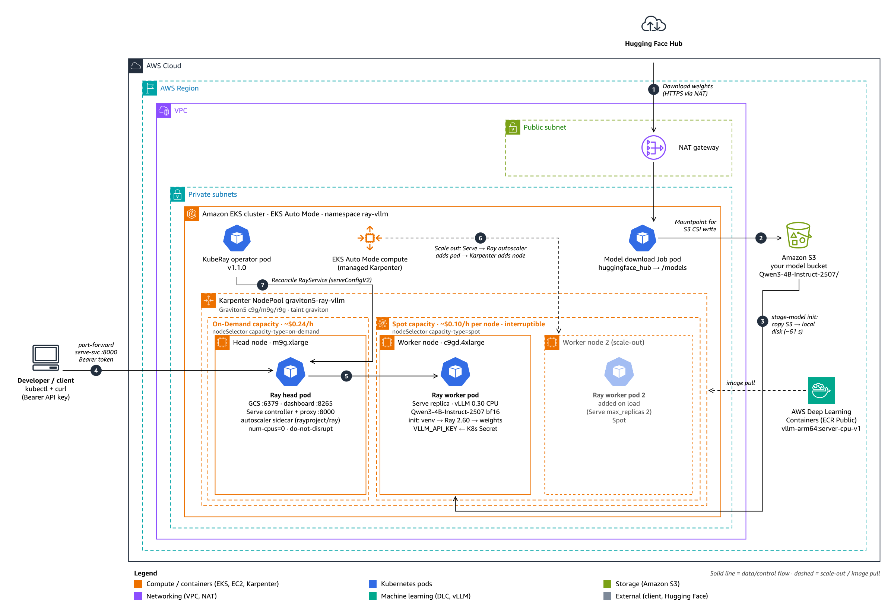
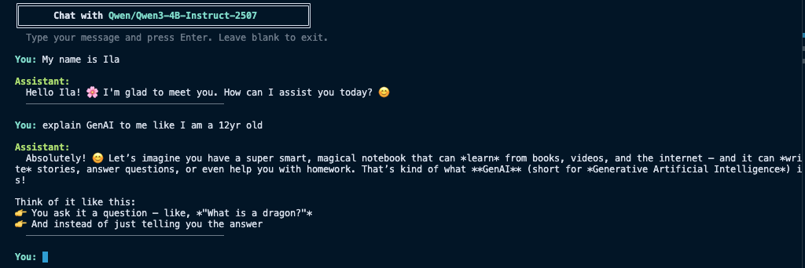
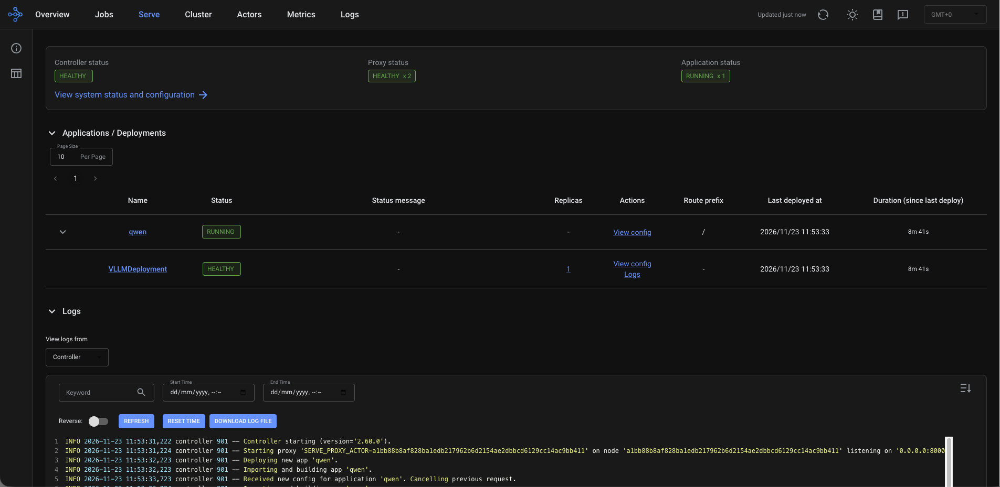

# How to scale LLM serving with Ray Serve and vLLM on Graviton5 CPUs on Amazon EKS Auto Mode

This sample serves [`Qwen/Qwen3-4B-Instruct-2507`](https://huggingface.co/Qwen/Qwen3-4B-Instruct-2507)
through [Ray Serve](https://docs.ray.io/en/latest/serve/index.html) and
[vLLM](https://docs.vllm.ai/) on AWS Graviton5 (Arm64) CPUs, with no GPU, on an
[Amazon EKS Auto Mode](https://docs.aws.amazon.com/eks/latest/userguide/automode.html)
cluster. It uses the
[vLLM Arm64 CPU Deep Learning Container (DLC)](https://gallery.ecr.aws/deep-learning-containers/vllm-arm64)
(`public.ecr.aws/deep-learning-containers/vllm-arm64:server-cpu-v1`) and the
[KubeRay](https://docs.ray.io/en/latest/cluster/kubernetes/index.html) `RayService`.

The [vLLM on Graviton5 sample](../how-to-vllm-serving-graviton-eks-auto-mode/) runs one
vLLM `Deployment` with a fixed size. This sample puts Ray Serve in front of vLLM so the
number of model replicas follows the load, and each layer scales the next:

```
Ray Serve autoscaler (ongoing requests per replica)
  -> Ray autoscaler adds a Ray worker pod
    -> EKS Auto Mode (Karpenter) launches another Graviton5 node
```

It also splits the Ray cluster across capacity types. The Ray head, which holds the
cluster state, runs on On-Demand capacity. The stateless Ray workers that host vLLM run
on Spot.



## How it works

| File | Purpose |
| --- | --- |
| `nodepool-graviton.yaml` | Karpenter `NodePool` that launches Graviton5 nodes (`c9g`/`m9g`/`r9g` and `d` variants), On-Demand or Spot, labelled `intent=ray-vllm` and tainted `graviton:NoSchedule`. |
| `model-download-job.yaml` | `ray-vllm` namespace, a Mountpoint for Amazon S3 `PersistentVolume`/`PersistentVolumeClaim` on your bucket, and a one-off `Job` that copies the model from Hugging Face into the bucket. |
| `vllm-serve-script.yaml` | `ConfigMap` with `vllm_serve.py`, the Ray Serve application. |
| `ray-service.yaml` | `RayService` `qwen-vllm`: Ray head, Graviton worker group, Serve config, and autoscaling settings. |
| `multi-turn-chat.sh` | Minimal multi-turn chat client for the OpenAI-compatible API. Takes the API key as its first argument. |

The Ray cluster has two kinds of pods:

- **Ray head** (On-Demand, about 2.5 vCPU / 8.5 GiB, fits an `m9g.xlarge`). It runs the
  Global Control Service (GCS), dashboard, Serve controller, Serve proxy, and the Ray
  autoscaler sidecar. It starts with `--num-cpus=0`, so it never hosts a model replica.
  Losing the head takes the whole Ray cluster down, which is why it stays On-Demand.
- **Ray worker** (Spot, 15 vCPU / 28 GiB requested, fits a 16-vCPU node such as
  `c9gd.4xlarge`). Each worker hosts one vLLM replica. Init containers copy the weights
  from S3 to node-local disk before vLLM starts.

`vllm_serve.py` does not re-implement the OpenAI routes. Each replica builds the same
FastAPI app that `vllm serve` builds (`build_app()` + `init_app_state()`) and hands it to
Ray Serve through the `__serve_build_asgi_app__` hook (Ray 2.60 and later). Every replica
exposes the full vLLM API (`/health`, `/v1/models`, `/v1/chat/completions`,
`/v1/completions`, `/metrics`), and you don't have to keep a copy of vLLM's routes in
step with each vLLM release.

### Security notes

- **Authentication.** Every request except `/health` needs `Authorization: Bearer <key>`.
  vLLM enforces this through the `VLLM_API_KEY` environment variable, read from a
  Kubernetes `Secret` that you create. The key is not stored in any file in this sample.
  A replica refuses to start without it.
- **Exposure.** KubeRay creates `ClusterIP` Services only. Reach them from your
  workstation with `kubectl port-forward`, which binds to localhost. Do not change them
  to `LoadBalancer` or `NodePort`.
- **The Ray dashboard (port 8265) has no authentication** and accepts job submission,
  which means arbitrary code execution for anyone who can reach it. Only open it with
  `port-forward`. If your cluster enforces `NetworkPolicy`, restrict ports 8265, 52365,
  and 6379 to the Ray pods (`app=qwen-vllm-ray`) and the KubeRay operator.
- **Storage.** The S3 bucket stays private. The model volume is mounted read-only in the
  Ray pods; only the download `Job` writes to it.

> This sample is for testing and learning only. Always follow the
> [Amazon EKS Security Best Practices](https://aws.github.io/aws-eks-best-practices/security/docs/)
> for production clusters.

## Prerequisites

1. An Amazon EKS cluster with **EKS Auto Mode** enabled. See the
   [eksctl Auto Mode sample](../../eksctl/how-to-eks-auto-mode/) to create one. Its nodes
   need outbound internet access (Hugging Face download and `pip install ray`).
2. The latest [AWS CLI](https://docs.aws.amazon.com/cli/latest/userguide/installing.html),
   [kubectl](https://docs.aws.amazon.com/eks/latest/userguide/install-kubectl.html), and
   [Helm](https://helm.sh/docs/intro/install/), configured for your cluster. `curl`,
   `jq`, and `openssl` on your workstation.
3. The **KubeRay operator**. This sample was tested with v1.1.0:

    ```sh
    helm repo add kuberay https://ray-project.github.io/kuberay-helm/
    helm repo update
    helm install kuberay-operator kuberay/kuberay-operator --version 1.1.0 \
      --namespace kuberay-system --create-namespace
    ```

4. A private S3 bucket for the model weights, in the same Region as the cluster:

    ```sh
    export AWS_REGION=<your-region>
    export MODEL_BUCKET=<your-unique-bucket-name>
    aws s3api create-bucket --bucket "$MODEL_BUCKET" --region "$AWS_REGION" \
      --create-bucket-configuration LocationConstraint="$AWS_REGION"
    ```

    In `us-east-1`, omit `--create-bucket-configuration`. New buckets block public
    access by default.

5. The [Mountpoint for Amazon S3 CSI driver](https://docs.aws.amazon.com/eks/latest/userguide/s3-csi.html)
   EKS add-on (`aws-mountpoint-s3-csi-driver`). Give the driver an IAM role (EKS Pod
   Identity or IRSA, as described in the linked guide) with a policy scoped to your
   bucket:

    ```json
    {
      "Version": "2012-10-17",
      "Statement": [
        {
          "Sid": "ListModelBucket",
          "Effect": "Allow",
          "Action": "s3:ListBucket",
          "Resource": "arn:aws:s3:::<your-unique-bucket-name>"
        },
        {
          "Sid": "ReadWriteModelObjects",
          "Effect": "Allow",
          "Action": ["s3:GetObject", "s3:PutObject", "s3:AbortMultipartUpload"],
          "Resource": "arn:aws:s3:::<your-unique-bucket-name>/*"
        }
      ]
    }
    ```

## Usage

1. Create the Graviton5 `NodePool`:

    ```sh
    kubectl apply -f nodepool-graviton.yaml
    kubectl get nodepool graviton5-ray-vllm
    ```

2. Create the namespace, the S3 volume, and stage the model in S3. This is a one-time
   step that takes a few minutes:

    ```sh
    sed -e "s|<MODEL_BUCKET>|${MODEL_BUCKET}|g" -e "s|<AWS_REGION>|${AWS_REGION}|g" \
      model-download-job.yaml | kubectl apply -f -

    kubectl -n ray-vllm wait --for=condition=complete \
      job/download-qwen3-4b-instruct-2507 --timeout=30m
    kubectl -n ray-vllm logs job/download-qwen3-4b-instruct-2507 --tail=3
    ```

3. Create the API-key `Secret`. Worker pods do not start without it:

    ```sh
    kubectl -n ray-vllm create secret generic ray-vllm-api-key \
      --from-literal=api-key="$(openssl rand -hex 32)"
    ```

4. Deploy the Serve application and the `RayService`:

    ```sh
    kubectl apply -f vllm-serve-script.yaml
    kubectl apply -f ray-service.yaml
    ```

5. Wait until the service reports `Running`. From a cold start this takes about 6 to 8
   minutes:

    ```sh
    kubectl -n ray-vllm get rayservice qwen-vllm -o jsonpath='{.status.serviceStatus}{"\n"}'
    kubectl -n ray-vllm get pods -l app=qwen-vllm-ray -o wide
    kubectl get nodeclaims -l intent=ray-vllm
    ```

    Cold-start timeline measured during testing:

    | Phase | Time |
    | --- | --- |
    | Node launch and image pull (about 7 GB) | 1 to 2 min |
    | `stage-venv` and `install-ray` init containers | about 1 min |
    | `stage-model` (7.6 GB from S3 to local disk) | about 61 s |
    | Weight load (3 shards) | about 52 s |
    | Engine init, KV cache, and warmup | about 42 s |

6. Port-forward the Serve endpoint:

    ```sh
    kubectl -n ray-vllm port-forward svc/qwen-vllm-serve-svc 8000:8000
    ```

7. In another terminal, read the API key and call the OpenAI-compatible API:

    ```sh
    export TOKEN=$(kubectl -n ray-vllm get secret ray-vllm-api-key -o jsonpath='{.data.api-key}' | base64 -d)

    curl -s http://localhost:8000/health        # 200, no token needed
    curl -s -H "Authorization: Bearer $TOKEN" http://localhost:8000/v1/models | jq .

    curl -s http://localhost:8000/v1/chat/completions \
      -H "Authorization: Bearer $TOKEN" -H "Content-Type: application/json" \
      -d '{
        "model": "Qwen/Qwen3-4B-Instruct-2507",
        "messages": [{"role": "user", "content": "Explain generative AI to a first grader in two sentences."}],
        "max_tokens": 100
      }' | jq -r '.choices[0].message.content'
    ```

8. (Optional) Chat interactively. Pass the API key as the first argument, or leave it
   out to use the `TOKEN` variable exported in the previous step. The script keeps the
   conversation history, so the model remembers earlier turns:

    ```sh
    ./multi-turn-chat.sh "$TOKEN"
    ```

    

9. (Optional) Open the Ray dashboard to see Serve status, replicas, logs, and autoscaler
   activity:

    ```sh
    kubectl -n ray-vllm port-forward svc/qwen-vllm-head-svc 8265:8265
    ```

    Then browse to http://localhost:8265 and open the **Serve** tab.

    

## Watch it scale

The Serve config targets 8 ongoing requests per replica (`target_ongoing_requests`) and
allows up to 2 replicas. Send more concurrent requests than one replica's target and
hold the load for longer than `upscale_delay_s` (30 seconds):

```sh
seq 200 | xargs -P 24 -I{} curl -s -o /dev/null -w '%{http_code}\n' \
  -H "Authorization: Bearer $TOKEN" -H "Content-Type: application/json" \
  http://localhost:8000/v1/chat/completions \
  -d '{"model": "Qwen/Qwen3-4B-Instruct-2507",
       "messages": [{"role": "user", "content": "Write a 300-word story about a robot that learns to paint."}],
       "max_tokens": 400}' | sort | uniq -c
```

While it runs, watch each layer react in another terminal:

```sh
kubectl -n ray-vllm get pods -l app=qwen-vllm-ray -w     # a second worker pod appears
kubectl get nodeclaims -l intent=ray-vllm -w             # Karpenter launches a Spot node
```

```sh
H=$(kubectl -n ray-vllm get pods -l app=qwen-vllm-ray,ray.io/node-type=head -o name | head -1)
kubectl -n ray-vllm exec $H -c ray-head -- serve status   # VLLMDeployment replicas: 2
kubectl -n ray-vllm exec $H -c ray-head -- ray status     # nodes, CPUs, pending demand
```

The new replica serves traffic after the same cold start as the first worker (several
minutes). Requests above the replicas' capacity queue in Ray Serve until then, up to
`max_ongoing_requests` (32) per replica. When the load stops, Serve removes the extra
replica after `downscale_delay_s` (10 minutes). The Ray autoscaler then removes the idle
worker after `idleTimeoutSeconds` (5 minutes), and EKS Auto Mode removes the empty node.

## Comparing On-Demand and Spot cost

Both Ray pod types use the same `NodePool`. Only the `karpenter.sh/capacity-type`
`nodeSelector` in `ray-service.yaml` decides where they land:

```yaml
          # head
          nodeSelector:
            intent: ray-vllm
            karpenter.sh/capacity-type: on-demand
          ...
          # workers
          nodeSelector:
            intent: ray-vllm
            karpenter.sh/capacity-type: spot
```

See which instance and capacity type each Ray pod got:

```sh
kubectl get nodes -l intent=ray-vllm \
  -L node.kubernetes.io/instance-type \
  -L karpenter.sh/capacity-type \
  -L topology.kubernetes.io/zone
```

[`eks-node-viewer`](https://github.com/awslabs/eks-node-viewer) shows a live cost
estimate per node:

```sh
eks-node-viewer -extra-labels karpenter.sh/nodepool,topology.kubernetes.io/zone \
  -node-selector intent=ray-vllm
```

During testing in `us-east-1`, `eks-node-viewer` reported these hourly prices, which
include the EKS Auto Mode management fee. Prices vary by Region and over time, and Spot
prices change with demand.

| Setup | Nodes | Cost per hour |
| --- | --- | --- |
| Head and worker together, On-Demand | 1 x `c9g.8xlarge` | about $1.65 |
| Head On-Demand, worker on Spot | `m9g.xlarge` On-Demand + `c9gd.4xlarge` Spot | about $0.34 |

Trade-offs of running workers on Spot:

- A Spot interruption gives 2 minutes' notice. The replacement worker needs a new node,
  the weight copy, and vLLM startup, so a single-worker setup serves no traffic for a
  few minutes. Run `minReplicas: 2` (and Serve `min_replicas: 2`) if you need to ride
  through interruptions. The `karpenter.sh/do-not-disrupt` annotation does not prevent
  Spot reclaims.
- The worker requests 15 vCPU, so it only just fits a 16-vCPU node after DaemonSets. If
  it doesn't fit, Karpenter picks a larger instance. Lower the worker requests (and
  `--num-cpus` and `num_cpus` to match) if you see 32-vCPU nodes launched.
- Allowing several instance families and sizes in the `NodePool` gives Spot more
  capacity pools to choose from, which lowers the interruption rate.

## Configuration

Model and engine settings live in `serveConfigV2` → `runtime_env.env_vars` in
`ray-service.yaml`. `vllm_serve.py` turns them into `vllm serve` flags:

| Variable | Value | Meaning |
| --- | --- | --- |
| `MODEL_ID` | `/local-models/Qwen3-4B-Instruct-2507` | `--model`, the path staged by the `stage-model` init container |
| `SERVED_MODEL_NAME` | `Qwen/Qwen3-4B-Instruct-2507` | value clients send in `"model"` |
| `DTYPE` | `bfloat16` | `--dtype` |
| `MAX_MODEL_LEN` | `4096` | `--max-model-len` |
| `MAX_NUM_SEQS` | `16` | `--max-num-seqs` |
| `VLLM_EXTRA_ARGS` | not set | any other `vllm serve` flags, shell-quoted |
| `VLLM_CPU_KVCACHE_SPACE` | `8` | CPU KV cache in GiB, reserved on top of the ~7.5 GiB of weights |
| `VLLM_CPU_OMP_THREADS_BIND` | `auto` | pins OpenMP threads to cores |
| `LD_PRELOAD` | `libtcmalloc_minimal.so.4` | tcmalloc. The DLC entrypoint normally sets it, but Ray bypasses that entrypoint |

Autoscaling settings (`deployments[0]`):

| Setting | Value |
| --- | --- |
| `min_replicas` / `max_replicas` | 1 / 2 |
| `target_ongoing_requests` | 8 per replica |
| `max_ongoing_requests` | 32 per replica |
| `upscale_delay_s` / `downscale_delay_s` | 30 / 600 |
| `ray_actor_options.num_cpus` | 14 (each worker starts with 15 Ray CPUs) |

Keep Serve `max_replicas` and the worker group's `maxReplicas` equal, because each worker
hosts one replica. Weights, KV cache, and vLLM and Ray overhead must all fit under the
worker's memory limit (40 GiB).

Changing only `serveConfigV2` (environment variables, autoscaling) updates the Serve
application in place when you re-apply `ray-service.yaml`. Any change under
`rayClusterConfig` makes KubeRay build a new Ray cluster. After editing
`vllm-serve-script.yaml`, apply it and recreate the `RayService`.

### Changing the model

1. Edit the repository ID and target directory in `model-download-job.yaml` and rerun
   the `Job`.
2. Update the `cp` source in the worker's `stage-model` init container and the
   `model-cache` `sizeLimit` in `ray-service.yaml`.
3. Update `MODEL_ID` and `SERVED_MODEL_NAME`, and resize `VLLM_CPU_KVCACHE_SPACE` and the
   worker memory for the new model. The CPU backend needs BFloat16 safetensors; it does
   not support GGUF.

## Design notes

- **The vLLM CPU image has no Ray.** KubeRay 1.1 injects a `wait-gcs-ready` init
  container into worker pods that runs `ray health-check` with the worker's image,
  environment, and volume mounts. Without Ray it loops on `ray: command not found`. The
  `stage-venv` init container copies `/opt/venv` to an `emptyDir`, `install-ray` runs
  `pip install 'ray[serve]==2.60.0'` into it, and that `emptyDir` is mounted over
  `/opt/venv` in the Ray containers, so the injected init container sees Ray too. The
  autoscaler sidecar uses `rayproject/ray:2.60.0` (multi-arch).
- **Use Ray 2.60.0.** The image ships protobuf 7, and older Ray releases such as 2.53
  fail at Serve deploy with `'FieldDescriptor' object has no attribute 'label'`.
- **Copy the weights to local disk; don't load them from the S3 mount.** vLLM's
  memory-mapped reads over Mountpoint for Amazon S3 ran at about 3 MiB/s. A sequential
  copy runs at about 600 MiB/s, so the `stage-model` init container copies the 7.6 GB in
  about a minute.
- **Protect Ray pods from consolidation.** The `NodePool` consolidates underutilized
  nodes, which evicted the Ray head during testing. Both pod templates carry
  `karpenter.sh/do-not-disrupt: "true"`, and the Ray autoscaler owns scale-down.
- **Use `@serve.ingress()` with `__serve_build_asgi_app__`.** Ray Serve serializes a
  module-level FastAPI app when the class is decorated, so routes added later in
  `__init__` never appear and every request returns 404.
- **The DLC tag floats.** `server-cpu-v1` has moved between vLLM releases (0.30 and 0.33
  were both tested with this script). Pin the image by digest for repeatable deployments.
- **Expected log noise:** `Triton not available`, `numa_migrate_pages` /
  `set_mempolicy: Operation not permitted`, and "replica has taken more than 30s to
  initialize" while weights load.

## Troubleshooting

```sh
H=$(kubectl -n ray-vllm get pods -l app=qwen-vllm-ray,ray.io/node-type=head -o name | head -1)
W=$(kubectl -n ray-vllm get pods -l app=qwen-vllm-ray,ray.io/node-type=worker -o name | head -1)

kubectl -n ray-vllm exec $H -c ray-head -- serve status    # application and replica state
kubectl -n ray-vllm exec $H -c ray-head -- ray status      # nodes, CPUs, pending demand
kubectl -n ray-vllm logs $W -c stage-model                 # "Staged 7.6G in 61s"
kubectl -n ray-vllm exec $W -c ray-worker -- bash -c \
  'tail -n 50 /tmp/ray/session_latest/logs/worker-*-01000000-*.err'   # vLLM replica log
```

| Symptom | Likely cause |
| --- | --- |
| Worker stuck in `Init`, `wait-gcs-ready` logs `ray: command not found` | the `ray-venv` mount is missing from the worker container |
| Serve `DEPLOY_FAILED` with `FieldDescriptor ... 'label'` | Ray too old for protobuf 7. Use 2.60.0 |
| `Available memory on node 0 ... less than requested memory for kv` | `VLLM_CPU_KVCACHE_SPACE` + weights + overhead exceed the worker memory limit |
| "taken more than 30s to be scheduled ... CPU: 14" | waiting for a worker pod or node, or `max_replicas` is larger than `maxReplicas` |
| Head pod recreated, `Evicted pod: Underutilized` in events | `karpenter.sh/do-not-disrupt` annotation missing |
| Worker pod `CreateContainerConfigError` | the `ray-vllm-api-key` Secret doesn't exist |
| `401` from the API | wrong or missing bearer token. A running pod keeps the key it started with |
| Download `Job` fails with `AccessDenied` | the Mountpoint CSI driver role lacks the bucket policy above |

## Cleanup

```sh
kubectl delete -f ray-service.yaml          # Ray cluster; EKS Auto Mode then removes the nodes
kubectl delete -f vllm-serve-script.yaml
kubectl -n ray-vllm delete secret ray-vllm-api-key
kubectl delete -f model-download-job.yaml   # Job, PVC, PV, and the ray-vllm namespace
kubectl delete -f nodepool-graviton.yaml
```

The weights stay in S3 because the `PersistentVolume` reclaim policy is `Retain`. To
delete them and the bucket:

```sh
aws s3 rm "s3://${MODEL_BUCKET}/Qwen3-4B-Instruct-2507/" --recursive
aws s3api delete-bucket --bucket "$MODEL_BUCKET" --region "$AWS_REGION"
```

Uninstall the KubeRay operator and the Mountpoint for Amazon S3 CSI driver add-on if you
installed them only for this sample.

## Production considerations

- Bake Ray into an image (`FROM` the vLLM Arm64 DLC plus `pip install 'ray[serve]==2.60.0'`)
  and push it to Amazon ECR. This removes the venv copy and `pip install` from every pod
  start and the need for outbound access to PyPI.
- Use a current KubeRay operator release. This sample was tested with v1.1.0.
- Add an S3 gateway VPC endpoint so model reads don't go through the NAT gateway.
- Enforce `NetworkPolicy` and restrict the Ray ports as described in
  [Security notes](#security-notes).

## References

- [Ray Serve autoscaling](https://docs.ray.io/en/latest/serve/autoscaling-guide.html)
- [KubeRay RayService](https://docs.ray.io/en/latest/cluster/kubernetes/getting-started/rayservice-quick-start.html)
- [vLLM Deep Learning Containers](https://aws.github.io/deep-learning-containers/vllm/)
- [Running vLLM on AWS Graviton](https://github.com/aws/aws-graviton-getting-started/blob/main/machinelearning/vllm.md)
- [Mountpoint for Amazon S3 CSI driver](https://docs.aws.amazon.com/eks/latest/userguide/s3-csi.html)
- [Amazon EKS Auto Mode](https://docs.aws.amazon.com/eks/latest/userguide/automode.html)
